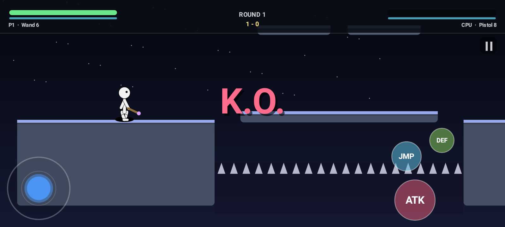
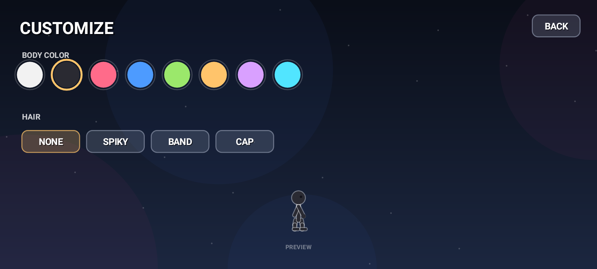
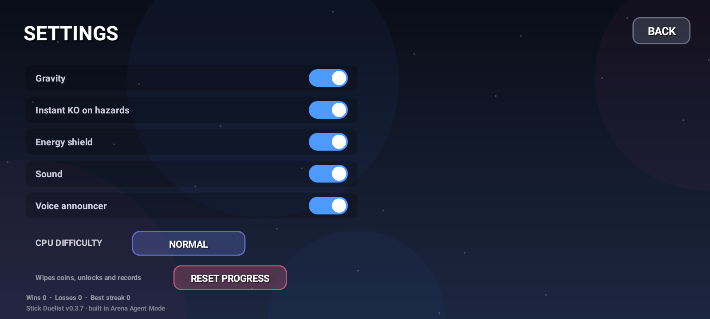

# Stick Duelist

A native Android 2D stick-fighting game in the spirit of *Supreme Duelist Stickman* (Neron's Brother) — original code and art, built from scratch.

It is a **tribute, not a port**: 12 weapons, 10 arenas and three modes out of the original's 66 weapons, 46 maps and full party/ragdoll sandbox. See [the gap analysis](docs/REVIEW.md) for an honest side-by-side.

**Install:** grab the APK from the [latest release](https://github.com/kb019063-hue/jarvis-v2/releases/latest) and side-load it (Android 7.0+, allow unknown sources). Landscape, touch only, works offline.

<p align="center"></p>

## Screenshots

These are rendered by the test suite on every push (Robolectric draws real frames to PNG), so they always match the current build.

| | |
|---|---|
|  |  |
|  |  |
|  |  |
|  |  |
|  |  |

## What's in it

**Fighters**
- Arcade stick-figure combat with knockback, hit-stop, screen shake, sparks/blood/confetti
- KO launches the loser into a spinning, tumbling fall (the body is a rigid tumble, not a limb-by-limb ragdoll — see the gap analysis)
- Energy shield (drains when hit, breaks into a stun), crouch, coyote-time jumps
- Health + shield bars, round pips, floating damage numbers

**Weapons (12, unlockable with coins)**
- Melee: Fists, Sword, Spear, Dual Sabers, Hammer, Energy Blade
- Thrown: Kunai, Bomb (splash), Boomerang (returns for a second hit)
- Projectile: Bow, Wand (homing bolts), Pistol
- Weapons drop from the sky mid-match — walk over one to grab it. Ammo is finite.

**Arenas (10)**
- Rooftop Dusk, Neon Alley, Lava Core, Sky Temple, Frozen Lake, Bamboo Grove, Orbital Deck, Volcano Rim, Dojo Night, Chaos Pit
- Water / lava / spike hazards, pits, floating platforms, themed skies and parallax backdrops

**Modes**
- **Quick Fight** — best-of-3 vs CPU (4 difficulties)
- **Local Duel** — 2 players on one device, mirrored joystick + button clusters
- **Survival** — endless waves, tougher enemies, score tracking

**Meta**
- Coins for wins and takedowns, weapon shop/arsenal, body colours, hair styles
- House rules from the original: gravity on/off, instant KO on hazards, energy shield on/off
- With the energy shield off, DEF makes your fighter bend down (like the original)
- Voice announcer ("Three… Two… One… Fight!", "K.O.", "Victory") + synthesized sound effects
- Everything persists in `SharedPreferences`

## Controls

| | Move | Attack | Jump | Shield |
|---|---|---|---|---|
| 1P | left thumbstick (whole left half) | ATK (right) | JMP | DEF |
| 2P left | left stick | ATK | JMP | DEF |
| 2P right | right stick | ATK | JMP | DEF |

Hold ATK to keep swinging on cooldown. Push the stick up or down while throwing to aim.
DEF blocks with any weapon; with the energy-shield rule switched off it crouches instead.

## How close is it to the original?

Honest scorecard against *Supreme Duelist Stickman* (see [docs/REVIEW.md](docs/REVIEW.md)):

| | Original | This build |
|---|---|---|
| Core loop (1v1 stick duel, weapon drops, hazards) | ✅ | ✅ |
| House rules (gravity / instant KO / energy shield) | ✅ | ✅ |
| Local 2P on one device | ✅ | ✅ |
| Ragdoll physics on every hit | ✅ | ❌ arcade fighter, ragdolls only after death |
| 3–4 player party mode | ✅ | ❌ |
| Football, boss tournament, zombie mode | ✅ | ❌ |
| Map editor | ✅ | ❌ |
| Content volume | 66 weapons / 46 maps | 12 weapons / 10 maps |
| Online play | ❌ (local only) | ❌ |

So: the *feel* of the duel and the rule set are recognisably Supreme Duelist, the *sandbox* is not.

## Build

Requires JDK 17 + the Android SDK (compileSdk 34).

```bash
./gradlew assembleDebug          # or: gradle assembleDebug
./gradlew testDebugUnitTest      # Robolectric smoke tests
```

No Gradle wrapper is committed — the CI workflow installs Gradle 8.7 and the SDK itself, so every push produces a signed debug APK plus a GitHub release with a downloadable `stick-duelist-<n>.apk`.

## Structure

```
app/src/main/java/com/arena/duelist/
  MainActivity.java   activity, immersive fullscreen, TTS announcer, haptics
  GameView.java       SurfaceView + fixed-timestep render loop, multi-touch routing
  Game.java           screens, match flow, combat resolution, HUD, menus, touch controls
  Fighter.java        movement, attacks, shield, ragdoll death, stick-figure rendering
  Weapons.java        12 weapon definitions
  Projectile.java     kunai/arrow/bolt/bomb/boomerang behaviour
  Maps.java           10 arenas: platforms, hazards, themes
  Cpu.java            spacing/punish AI with 4 difficulty levels
  Particles.java      sparks, blood, dust, shockwaves, confetti, floating text
  Painter.java        canvas helpers, gradients, text
  SoundFx.java        on-device WAV synthesis -> SoundPool
  Profile.java        coins, unlocks, settings, records
app/src/test/java/com/arena/duelist/SmokeTest.java   full-match rendering tests
```

## Roadmap

- [ ] Wi-Fi LAN link (host/join over the same network, NsdManager discovery)
- [ ] Map editor
- [ ] Football mini-game, boss tournament
- [ ] Weapon skins and per-weapon upgrades
- [ ] Online play

---

Not affiliated with Neron's Brother. Fan-made, original code and assets — no assets from the original game are used.
