# Stick Duelist

A native Android 2D stick-fighting game inspired by Neron's Brother's *Supreme Duelist Stickman*, built with original Java code and Canvas artwork.

**Scope:** this is an independent, incomplete recreation—not a port and not feature-parity with the original. The current build has 12 weapons, 10 arenas and five mode families (six CPU/local entries). The larger content roster, 3–4 player party play, additional minigames, map editor and Wi-Fi multiplayer are still absent. See [the fidelity audit](docs/FIDELITY-AUDIT.md) for the exact boundary.

**Install (latest test build):** download the APK from the [latest release](https://github.com/kb019063-hue/jarvis-v2/releases/latest) and side-load it on Android 7.0 or newer (allow unknown sources). Landscape, touch-only and offline. Releases are debug-signed test builds, not store-ready production packages.

<p align="center">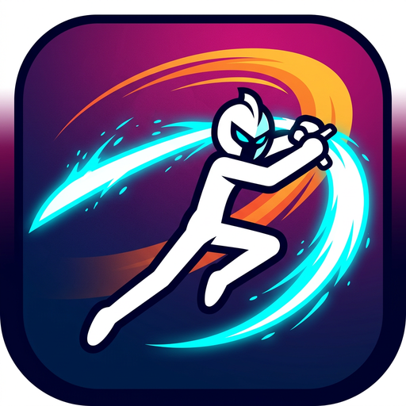</p>

## Screenshots

The Robolectric suite renders real game frames to PNG on every CI push; these are not mock-ups.

| | |
|---|---|
| 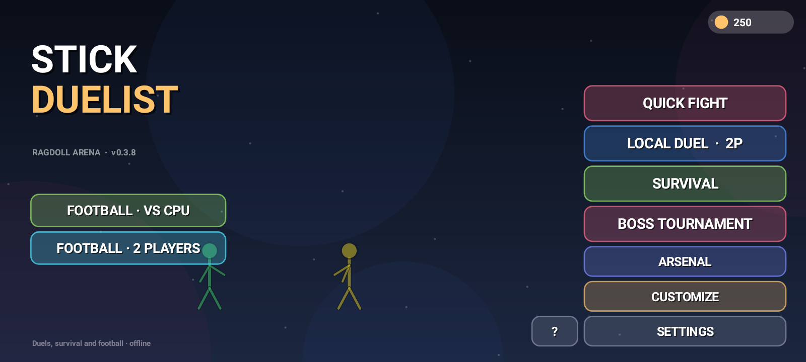 | 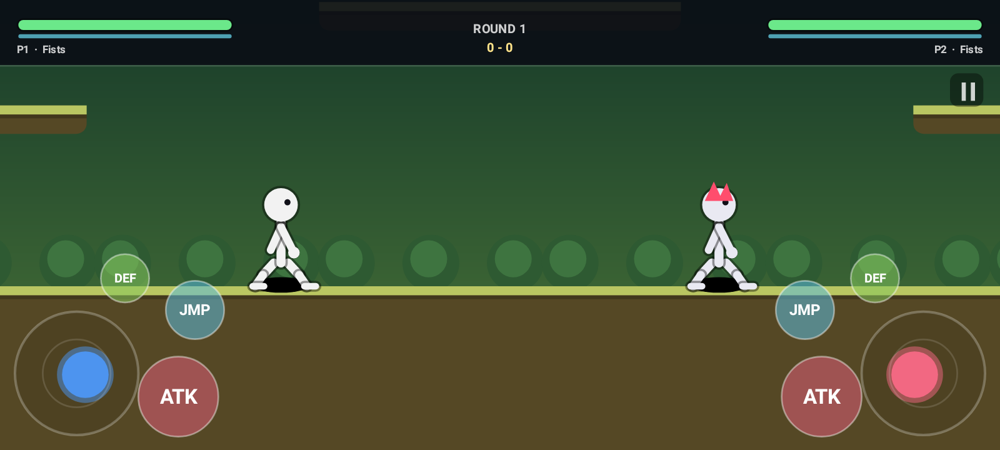 |
| 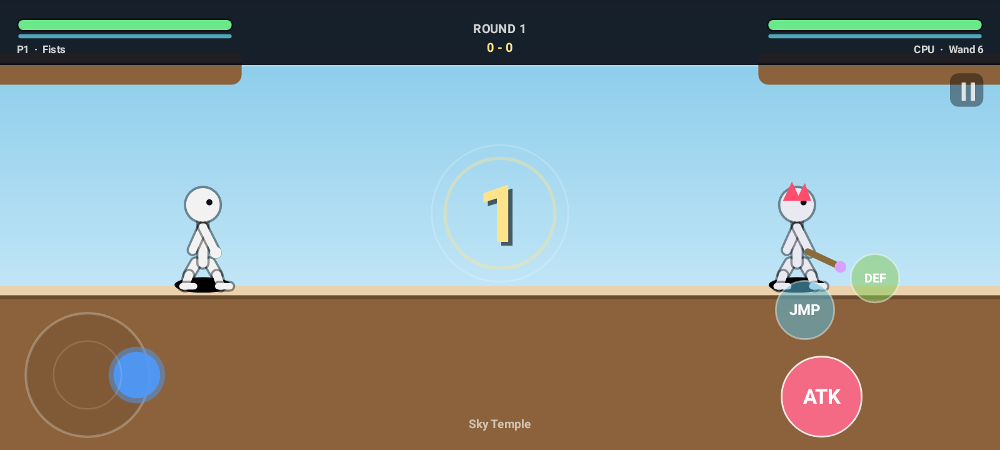 | 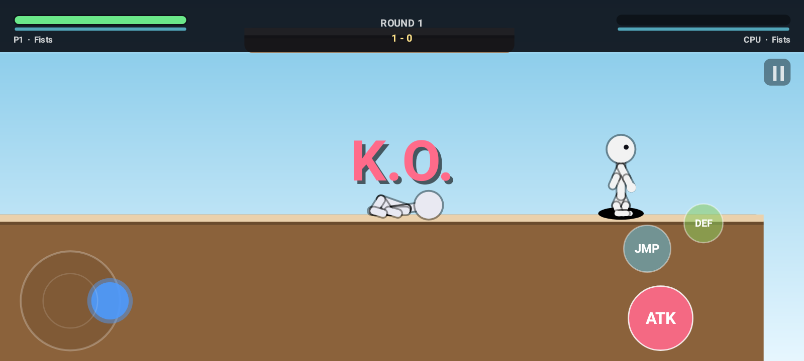 |
| 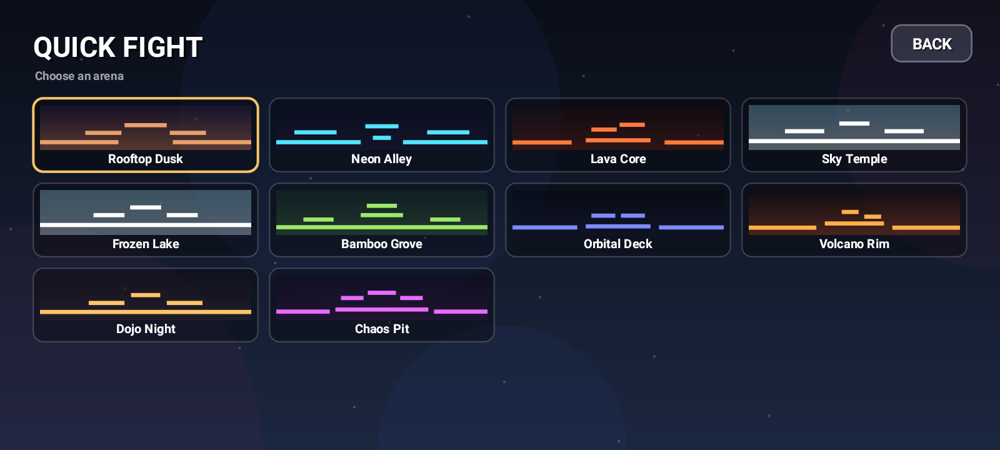 | 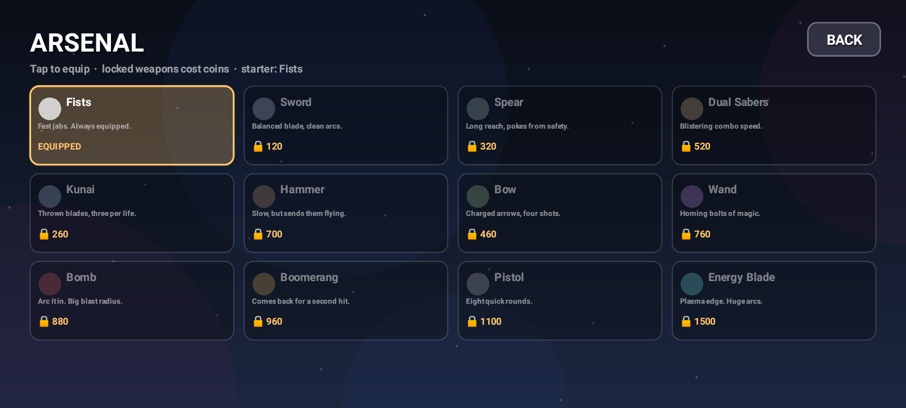 |
| 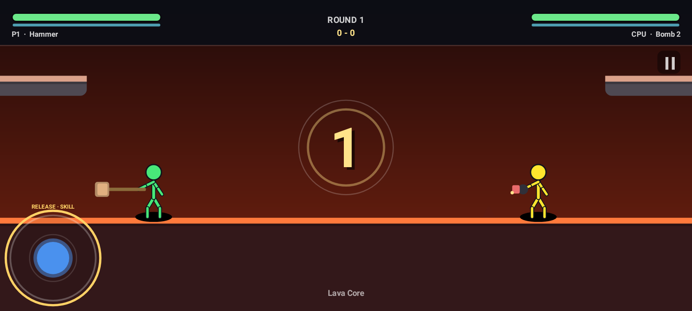 | 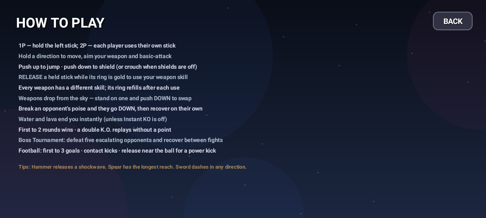 |
| 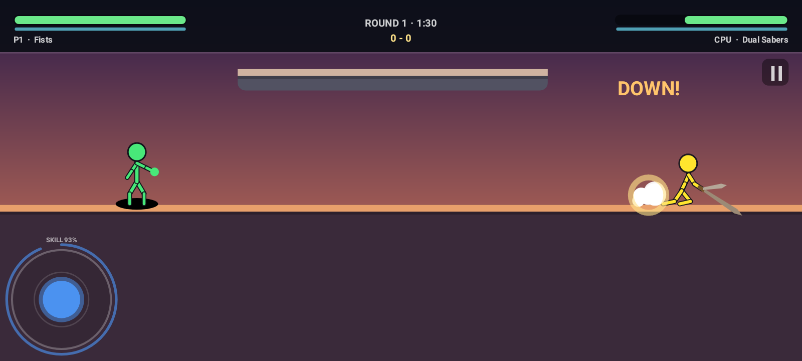 | 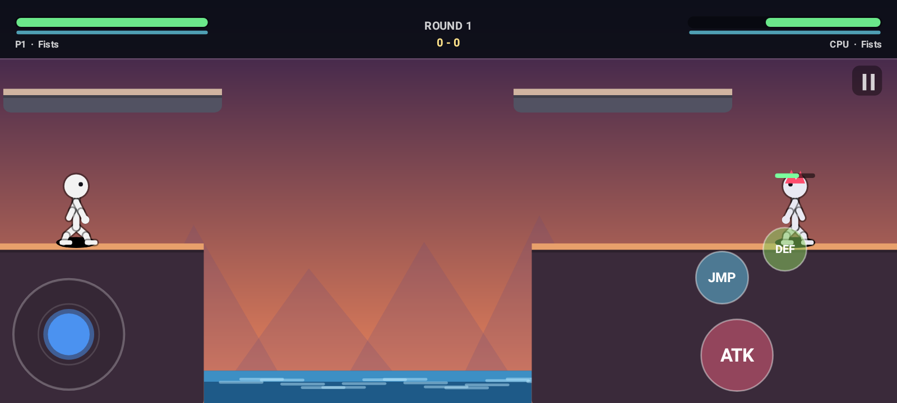 |
| 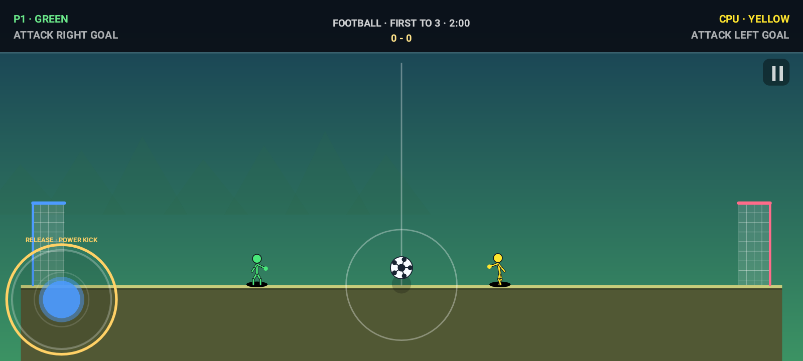 | 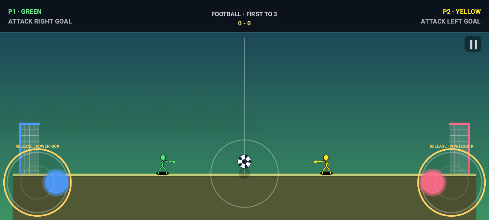 |

More frames, including every arena and ragdoll states, are in [`docs/screenshots`](docs/screenshots).

## Controls

There are **no separate attack, jump or defend buttons**. Each fighter uses one stick:

| Input | Action |
|---|---|
| Hold a direction | Move, aim the visible weapon and basic-attack automatically on cooldown |
| Push up | Jump once per upward push; return toward neutral before jumping again |
| Hold down | Energy shield, or crouch when the energy-shield rule is off |
| Release a held direction while the outer ring is gold | Use the equipped weapon's skill in that direction |
| Pause icon | Pause, resume, restart, change arena or quit |

- **1P:** touch anywhere on the left half; the stick floats to the thumb.
- **Local 2P:** player 1 uses the lower-left stick and player 2 the lower-right stick, with independent pointer IDs.
- The outer ring refills after a skill. A release with insufficient stick deflection does not spend the skill.

## What's in it

### Combat and physics

- Active 11-joint Verlet bodies for standing fighters, hit reactions, knockdowns and K.O.s—not only death animations.
- Bright green/yellow default fighters with clean dark outlines and simple round heads; the live fighter and customization preview share one pose renderer, and weapons stay attached through ragdoll falls.
- A counter-swinging walk cycle, subtle body bob, floor-anchored crouch with a shorter head hitbox, and weapon-specific wind-up, strike and follow-through poses.
- Melee attacks add a small weapon-weighted step, align fists' hit distance with the drawn arm, and sample the swung weapon segment across the frame; this is still not a full continuous physics simulation.
- Poise breaks, limp knockdowns, automatic recovery and brief recovery invulnerability.
- Directional melee knockback, projectile combat, shields, hit-stop, shake, sparks, dust and damage text.
- Fixed 60 Hz game simulation, timestep-aware ragdoll integration and second-based projectile lifetimes.
- CPU engagement at physical weapon range, ranged fire while repositioning, committed platform routes, hazard retreats and four attack cadences.
- Thin ledges are one-way platforms; the jump impulse can clear the arenas' 170 px rises — every tier is a single 140 px step, so no ledge needs a precision jump.

### Football (new in 0.3.0)

Select **Football · VS CPU** or **Football · 2 Players** directly from the title screen.

- Dedicated enclosed stadium, physical bouncing/rolling ball, goal nets and full-pitch camera.
- First to **three goals** wins. Goals require the entire ball to cross the line below the crossbar.
- Use the same movement/jump stick. Contact kicks the ball; release toward the goal when nearby for a charged **power kick**.
- Green attacks right; yellow attacks left. Both sticks work simultaneously in local play.
- Football uses gravity and no combat damage, weapon pickups or hazard K.O.s, independent of duel house rules.
- Goal celebrations, fresh kickoffs, pause/restart/rematch and persistent match rewards.

This is an original implementation of the missing mode category, **not verified reproduction of the reference game's football rules or physics**.

### Weapons and release skills (12)

| Weapon | Release skill |
|---|---|
| Fists | Rushing power jab |
| Sword | Directional dash slash |
| Spear | Long lunge |
| Dual Sabers | All-around spin/shockwave |
| Kunai | Three-blade fan |
| Hammer | Heavy shockwave |
| Bow | Triple-arrow volley |
| Wand | Five seeking bolts |
| Bomb | Cluster throw |
| Boomerang | Twin returning blades |
| Pistol | Three-bullet spread |
| Energy Blade | Dash plus plasma wave |

Basic ranged attacks consume their displayed ammo. Skills use their own cooldown. Weapons also drop during non-Survival matches and can be collected by walking over them.

### Arenas (10)

Rooftop Dusk, Neon Alley, Lava Core, Sky Temple, Frozen Lake, Bamboo Grove, Orbital Deck, Volcano Rim, Dojo Night and Chaos Pit. Rebuilt in 0.3.9: **1,900–2,400 px wide, 940–1,080 tall, 51 platforms across three tiers**, with a floor that runs under the whole fighting area and lava/spike hazards confined to the outer flanks. Every tier is one 140 px jump from the one below, every upper platform is verified reachable by a real jump probe, and no hazard or hole touches the spawn lane. The camera zooms out to keep both fighters framed when they separate and stops at "whole arena visible".

### Modes

- **Football:** CPU or same-device two-player matches, first to three goals.

- **Quick Fight:** first to two rounds against the CPU; a double K.O. replays without awarding a point.
- **Local Duel:** two players on one device with the same one-stick control scheme.
- **Survival:** successive enemies, wave rewards, healing and increasing difficulty. A mutual K.O. is a player defeat, not a free wave.
- **Boss Tournament:** five custom boss fights with themed names, colors, weapons and rising health; earn a reward for each clean takedown, recover between fights, and win by defeating all five. This is an original implementation, not a reproduction of the original game's boss content.
- **Win streak bonus:** each consecutive win after the first pays +10 coins, capped at +50, shown on the result screen.

### Meta and accessibility

- Coins, two-tap weapon purchases, persistent starter selection, body colours and hair styles.
- Gravity, instant-KO hazard and energy-shield house rules. With the shield rule on, holding DOWN blocks 85 % of damage; the shield recharges after a short pause and a broken one comes back within a few seconds.
- Sound effects and a voice announcer with independent switches; disabling Voice suppresses match and UI speech.
- Persistent records and settings through `SharedPreferences`.

## Maps and camera in 0.3.9

The ten arenas were 1,300–1,500 px wide with three surfaces and two tiers, and
the camera could never zoom in because the whole map already fit on screen —
so every match looked the same and the maps felt cramped. They are now
1,900–2,400 px wide with **three tiers and 51 platforms**, and the camera frames
the pair instead of the room:

| At 1600 × 720 | 0.3.8 | 0.3.9 |
|---|---|---|
| Zoom, fighters on opposite edges | 0.71–0.81 | **0.46–0.58** |
| Visible world width | 1,478–1,696 px | **2,065–2,609 px** |
| Both fighters on screen | 10/10 arenas | 10/10 |
| Whole arena always visible | yes — always | only when the map fits |

The zoom floor is the trick: the camera widens until the arena fills the frame
and then stops, so separation zooms out exactly as far as the map allows. Pan
is clamped to the arena bounds, and in close combat the camera sits at the 1.45
ceiling with no fighter ever clipped (0 of 68,000 sampled fighter-frames).
Backdrops now repeat to each arena's own width instead of stopping at 1,500 px.

Bigger maps also exposed a CPU routing loop that the old three-platform maps
hid: the next-platform chooser flipped its choice whenever the CPU crossed the
opponent's x, so it paced between two ledges forever. It is now a breadth-first
search over the platform graph — `Stall` went 4/300 → **0/300** and the
oscillation jumps (up to 45 a match) went to zero. No aggression, reaction or
accuracy constant changed. Numbers and the exact scope:
[docs/IMPLEMENTATION-0.3.9.md](docs/IMPLEMENTATION-0.3.9.md).

## Draw allocations in 0.3.8

Every frame used to build new `Path`, `RectF` and `Paint` objects: a blade path
and hair path per fighter, an arc rect and paint, a whole `Painter` with three
`Paint`s, a `Btn` + `RectF` per menu button, and a path per background hill or
spike. Measured with counters in the harness graphics stubs:

| Scenario | before | after |
|---|---|---|
| Title screen | 13.0 objects/frame | **0** |
| Duel, Dojo Night | 15.0 | **0** |
| Duel, spike arena | 47.0 | **0** |

Everything is pooled behind reusable scratch objects, and
`tools/verify/Draw.java` fails if the count ever climbs again. Numbers:
[docs/IMPLEMENTATION-0.3.8.md](docs/IMPLEMENTATION-0.3.8.md).

## The shield in 0.3.7

Holding DOWN blocks 85 % of incoming damage while the shield lasts, but the
shield cost 1.8 points per point of damage — a sword shattered it in four hits,
a bomb in two — and once spent it never came back for the rest of the round.

- **1.0 shield points per point of damage:** a sword takes 6 hits, a bomb 3, a
  pistol 12. It still shrinks per hit, as in the original.
- **Recharge:** 22 points per second after 2.5 s without a blocked hit; a
  broken shield can be raised again at 35 % (measured 4.1 s after the break).
- **Guard break:** 0.45 s stagger. The old code asked for 0.7 s and then
  overwrote it with the ordinary 0.22 s hit-stun, so the punish never happened.
- Blocked hits still deal 15 % chip damage, so a shield cannot stall a match.

Holding the shield against a sword-wielding CPU now survives 9.0 s instead of
7.4 s. Numbers: [docs/IMPLEMENTATION-0.3.7.md](docs/IMPLEMENTATION-0.3.7.md).

## Matches always end in 0.3.6

Some matches could not finish. Football had no match clock — a goal was the
only exit — so two passive local players sat at 0–0 indefinitely (measured:
still running at 300 s). Duel rounds had no time limit either, and a round only
ends in a K.O., so two evenly matched idle players looped forever.

- **Football:** a 120 s match clock. At 0:00 the score decides, a tie is a draw.
- **Duel:** a 90 s round clock. The fighter with more remaining health takes the
  round; within 2 % it is a draw. A `MAX_ROUNDS` cap guarantees termination.
- **Draws** pay 25 coins and leave wins, losses and streak untouched.
- The clock is drawn in the HUD and turns red under 10 s.

The road-map item that led here, "the economy is too slow", was **retracted**:
24 simulated matches give a 27.2 s average match, 70 coins, 9,257 coins/hour,
and the full 7,580-coin roster in 105 matches (~0.8 hours of play). No reward
value changed. Numbers: [docs/IMPLEMENTATION-0.3.6.md](docs/IMPLEMENTATION-0.3.6.md).

## Weapon balance in 0.3.5

The earlier "the wand is the outlier" conclusion was measured against an idle
opponent, which flatters homing weapons and punishes melee. Against an
engaged-but-evasive target the wand is the second *slowest* ranged weapon — and
the real outlier is the Energy Blade.

- **Energy Blade**: 21 dmg / 0.52 s (40.4 dps, 38 % ahead of every other melee
  weapon) → 18 dmg / 0.60 s (30.0 dps). Still the strongest melee weapon, just
  not by a third. 6.1 s → 7.1 s time-to-kill.
- **The CPU started unarmed in 44 % of matches** (131/300 measured), and an
  unarmed CPU re-arms from drops only 58 % of the time. Unarmed starts are now
  10 %, so most fights feature an actual weapon.

A test now enforces a 31 dps ceiling on melee weapons so neither can silently
regress. Numbers: [docs/IMPLEMENTATION-0.3.5.md](docs/IMPLEMENTATION-0.3.5.md).

## Weapon handling in 0.3.4

Ranged and thrown weapons deleted themselves: firing the last round replaced
the weapon with bare fists for the rest of the round, so a 960-coin boomerang
was **one throw** (0.2 s of held fire) and a 1,100-coin pistol was 2.7 s.

- **Magazines reload.** 1.6 s (boomerang) to 3.0 s (bomb) after the last round;
  the weapon is never taken away, the HUD shows `reload`, and an empty magazine
  cannot swing.
- **Drops need a deliberate press.** Walking over one used to swap your weapon
  with no input. Stand on it and **push DOWN** instead; the weapon you were
  carrying is left on the floor, so a swap is reversible.
- Sustained damage stays below melee, and time-to-kill barely moved, so this
  fixes the handling without making ranged weapons dominant.

Numbers and method: [docs/IMPLEMENTATION-0.3.4.md](docs/IMPLEMENTATION-0.3.4.md).

## Game tempo in 0.3.3

The game was reported as "too fast — the AI, my attacks, everything". It was not
a clock bug (the loop is a fixed 60 Hz accumulator driven by measured time); the
tempo really was high. Holding the one stick auto-attacks, so the weapon cooldown
is the game's speed, and the light weapons fired 3.5–4.6 times a second with a
50 ms wind-up.

- Attack cadence roughly halved: pistol 4.6 → 2.7/s, dual sabers 4.3 → 2.5/s,
  fists 3.5 → 2.2/s. Damage, reach and knockback are unchanged.
- Every swing now has a readable wind-up (50 → 100 ms before a hit is live).
- Walk speed 360 → 320 px/s and gentler acceleration for less twitch.
- The jump is deliberately untouched, so the 170 px platform routes still work.

Full numbers and method: [docs/IMPLEMENTATION-0.3.3.md](docs/IMPLEMENTATION-0.3.3.md).

## Playability fixes in 0.3.2

An independent review of 0.3.1 found five defects, two of them match-breaking.
All five are fixed in this build; the measurements are in
[docs/IMPLEMENTATION-0.3.2.md](docs/IMPLEMENTATION-0.3.2.md) and the
content/fidelity boundary is documented in
[docs/FIDELITY-AUDIT.md](docs/FIDELITY-AUDIT.md).

- **CPU ledge stall (critical).** The platform router rejected any drop that did
  not move the CPU horizontally toward the opponent, so on a side ledge it
  stood still and the round never ended. 31 of 120 seeded matches stalled;
  now 0 of 600.
- **Gravity OFF (critical).** The house rule removed gravity entirely, so one
  jump carried the fighter 1363 px above the arena and it never came down.
  It is now a floaty low-gravity rule (450 px/s² with air damping and a sky
  clamp): a full jump peaks 177 px and lands.
- **Hazard avoidance.** Lava beneath a solid floor no longer counts as lethal
  for a grounded CPU.
- **Knockback was cancelled.** The walk controller overwrote the shove within
  two frames, so hit impulses and dash releases did almost nothing. Hits now
  hold a 0.2 s impulse window that brakes at 1200 px/s²: fist 11→24 px,
  sword dash reach 119→238 px.
- **Stun locked steering.** Being hit now slows movement to 45 % instead of
  freezing it for the whole hurt window.
- **Downed fighters take half damage** while recovering, so a knockdown is a
  punish rather than an automatic kill.

Verified in CI ([run 40100593158](https://github.com/kb019063-hue/jarvis-v2/actions/runs/40100593158)):
81 tests pass, the APK assembles, and the regenerated screenshots are from the
new build.

## Playability fixes in 0.3.1

This pass addresses phone reports of passive close-range AI, repeated corpse falls, pumping camera zoom and central pits that made fighting awkward:

- Fixed an impossible fist-attack distance (body separation prevented the CPU entering its old attack range).
- CPU basic melee now engages at physical weapon range; gunners shoot even when the opponent is close or while repositioning. Difficulties use different attack cadences.
- Removed the ragdoll recreation path that could respawn a completed corpse at its death position.
- Camera freezes during K.O./result sequences, fits living fighters within a HUD/control-safe viewport and uses zoom hysteresis rather than chasing corpses.
- Rebuilt all ten arena layouts around continuous floors with grounded, same-level spawns. No central pit splits the fighting area; optional ledges sit toward the sides.
- Reset CPU route state and camera framing at each new duel round.
- Added tests that require actual CPU damage on every map, basic melee contact for every melee weapon, close-range gunfire, corpse removal, K.O. camera stability and viewport visibility at four aspect ratios.

See [the playability notes](docs/IMPLEMENTATION-0.3.1.md). This remains a test build; real-phone feedback is still needed.

## Reliability fixes in 0.3.0

- Projectiles resolve the nearest platform/fighter contact rather than platform list order.
- Vibration permission is declared in the manifest.
- Background/focus interruption pauses gameplay and clears held controls; return via Resume.
- Loop shutdown waits briefly for termination, never starts a second loop while the old one is alive, and reports surface errors rather than swallowing every failure.

## Validation

The repository currently contains **81 authored Robolectric tests across three suites**. Coverage includes CPU damage/engagement on every map, close-range melee and ranged combat, continuous arena floors, non-repeating corpse cleanup, K.O. camera stability, viewport framing, football scoring, kickoff/result flow, CPU/local menu access and independent two-stick input, ball timing and power kicks, projectile event ordering, interruption pause, real touch release, weapon-specific attack wind-up/recovery, swept melee contact, crouch floor alignment, every weapon skill, double-K.O. and Survival outcomes, five-boss tournament progression/rewards and mutual-K.O. handling, purchase persistence, countdown lockout, voice gating, projectile timing, ragdoll timing across frame rates, thin-ledge traversal, weapon dps ceiling, CPU arming rate, magazine reloads, deliberate weapon pickups, attack-tempo and wind-up limits, match clocks and drawn matches, the win-streak bonus, shield durability and recharge, draw-path allocation, downed-fighter damage reduction, ledge descent to an opponent below, gravity-off containment, light-hit knockback, seeded matches reaching a result, first-map CPU survival/engagement, CPU opening survival in every hazard arena, menu transitions and rendering every arena/weapon combination.

Android CI runs both `assembleDebug` and `testDebugUnitTest`, publishes the rendered screenshots and uploads an installable APK. A green build is not a substitute for physical-device gameplay testing; touch feel, performance and full original-game parity remain separate validation tasks.

## Build

Requires JDK 17 and the Android SDK (compileSdk 34):

```bash
gradle assembleDebug
gradle testDebugUnitTest
```

No Gradle wrapper is committed. CI installs Gradle 8.7 and the SDK, then publishes `stick-duelist-<run>.apk`. The application metadata is currently `versionCode 13`, `versionName 0.3.9`.

## Structure

```text
app/src/main/java/com/arena/duelist/
  MainActivity.java   activity, immersive fullscreen, TTS announcer, haptics
  GameView.java       SurfaceView, fixed-step loop, multi-touch routing
  Game.java           screens, match flow, combat, HUD, menus, one-stick input
  Fighter.java        movement, attacks, weapon pose, shield and fighter state
  Ragdoll.java        11-joint Verlet body, constraints and platform collision
  Weapons.java        12 weapon definitions and skill descriptions
  Projectile.java     thrown/projectile state and second-based lifetime
  Maps.java           10 arenas, platforms, hazards and themes
  Football.java       ball physics, contacts, power kicks, goals and pitch rendering
  Cpu.java            engagement, ranged spacing, platform routes and edge checks
  Particles.java      combat and movement effects
  Painter.java        Canvas drawing helpers
  SoundFx.java        on-device synthesized sound effects
  Profile.java        coins, unlocks, settings and records
app/src/test/java/com/arena/duelist/SmokeTest.java
```

## Remaining parity work

- [ ] Side-by-side visual, animation and physics tuning against a selected current-version reference
- [ ] Original-scale weapon and arena roster
- [ ] 3–4 player local party matches
- [x] Football category: independent CPU/local implementation
- [ ] Reference-verified football fidelity and additional original modes
- [ ] Map editor
- [ ] Wi-Fi/LAN multiplayer
- [ ] Physical-device gameplay/performance validation
- [ ] Production signing, store assets and release hardening

---

Not affiliated with Neron's Brother. No assets from the original game are used.
